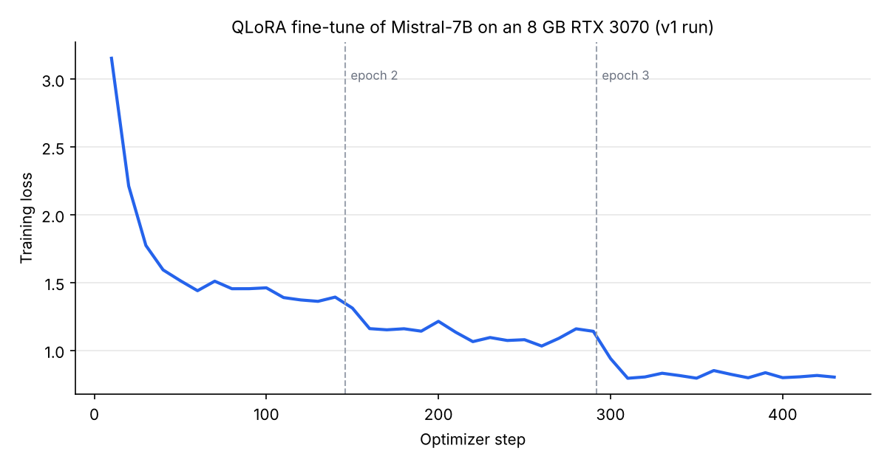

# local-llm-lab

Experiments with open-weight language models on one consumer GPU (RTX 3070, 8 GB VRAM), by Srinivas Jumbarthi. This is the self-directed groundwork that later became [Ramdos Arena](https://arena.ramdos.org), a live platform where Claude, Gemini, ChatGPT, Groq and Sarvam models debate and are scored by a blind LLM judge.

Everything here ran locally. Model weights, datasets and API keys are not included.

| Folder | What it is |
|---|---|
| [`fine_tuning/`](fine_tuning) | QLoRA fine-tuning of Mistral-7B in 4-bit on 8 GB, with the training log and loss curve |
| [`data_pipeline/`](data_pipeline) | A grounded synthetic-data pipeline that throws away generated Q&A containing invented facts |
| [`local_debate/`](local_debate) | The first version of Arena: two Mistral-7B personas debating on my own GPU |
| [`blind_judge/`](blind_judge) | A small, provider-agnostic blind LLM judge with a position-bias check |

## 1. QLoRA fine-tuning on 8 GB

Goal: teach Mistral-7B a consistent persona and identity ("Ramdas") from a few hundred grounded Q&A pairs, on hardware that cannot hold the model in 16-bit.

- 4-bit NF4 quantization with double quantization (bitsandbytes), gradient checkpointing
- LoRA r=16, alpha=32, dropout 0.05 on `q_proj`, `k_proj`, `v_proj`, `o_proj`
- Batch size 1 with 8 gradient-accumulation steps, lr 2e-4, 3 epochs, fp16
- About 1,160 training examples, 438 optimizer steps



Training loss fell from 3.15 to 0.80. Things I would flag myself:

- **Loss drops sharply at each epoch boundary.** That pattern usually means the model is starting to memorize a small dataset rather than generalize. There was no held-out set in this run, so I cannot separate the two yet.
- **v1 computed loss on the prompt and on padding tokens too.** [`train_lora_v2_masked.py`](fine_tuning/train_lora_v2_masked.py) fixes this by masking everything up to `[/INST]` and all padding, so only the assistant's answer is trained on. It also switches to a cosine schedule and paged 8-bit AdamW.

Raw logs: [`trainer_state.json`](fine_tuning/results/trainer_state.json), [`adapter_config.json`](fine_tuning/results/adapter_config.json).

## 2. Grounded synthetic data

[`grounded_qa_pipeline.py`](data_pipeline/grounded_qa_pipeline.py) turns a source document into training data with a local Mistral-7B (Q5_K_M GGUF via llama-cpp-python). A small model writing its own training data will happily invent names, places and dates, so every generated pair has to pass three filters before it is kept:

1. **Forbidden-entity regex**: rejects years, places and family words the source never mentions
2. **Token overlap** between the answer and the source passage
3. **Embedding similarity** (all-MiniLM-L6-v2): allows paraphrase but blocks drift

A pair that fails is replaced with an explicit "I do not see that in the text" answer, so the model also learns to refuse instead of inventing.

## 3. Local debate (first version of Arena)

[`local_debate/`](local_debate) is a Flask app where two personas, **Ram** (risk-aware) and **Krishna** (solution-focused), debate a topic turn by turn and then summarize the key takeaways. Both run on Mistral-7B quantized to Q2_K (about 2.7 GB) with llama-cpp-python, 20 layers offloaded to the GPU.

What I learned here shaped Arena: small quantized models drifted and repeated themselves within a few turns, and a 10-turn debate took minutes on one GPU. The production version moved to hosted APIs for speed and cost, and added web evidence, blind judging and hallucination checks.

```bash
pip install -r requirements.txt
export RAM_GGUF=models/mistral-q2_k.gguf KRISHNA_GGUF=models/mistral-q2_k.gguf
cd local_debate && python app.py      # then open ui/index.html
```

## 4. Blind judge

[`blind_judge.py`](blind_judge/blind_judge.py) is a small standalone version of the judging idea used in Arena:

- Answers are shuffled and shown to the judge only as "Model A", "Model B", ... so a model cannot recognize and favor its own family by name.
- Real names are mapped back only after the verdict is parsed.
- `position_bias_check` judges the same pair in both orders. A judge that changes its winner when only the order changed is reacting to position, not content.

The judge is any `prompt -> text` function, so it works with a local GGUF model or any hosted API. The tests use fake judges and run offline: `python blind_judge/test_blind_judge.py`.

Blinding by name does not stop a judge from recognizing a model by its writing style. Measuring that is the next experiment.

## Quantization notes

I built llama.cpp from source on Windows and converted several models to GGUF to see what fits and stays usable on 8 GB:

| Model | F16 | Q5_K_M | Q4_K_M | Q3_K_M | Q2_K |
|---|---|---|---|---|---|
| Mistral-7B | 14.5 GB | 5.1 GB | | 3.5 GB | 2.7 GB |
| Llama-3.1-8B-Instruct | 16.1 GB | 5.7 GB | | | |
| Phi-4-mini | 7.7 GB | 2.8 GB | 2.5 GB | 2.1 GB | 1.7 GB |
| Phi-3-mini-4k | 7.6 GB | | | 2.0 GB | |

## Setup

Python 3.10+, an NVIDIA GPU for training, and `llama-cpp-python` built with CUDA for GPU inference. Paths to models and data are set with environment variables (`BASE_MODEL`, `TRAIN_DATA`, `GGUF_MODEL`, `SOURCE_DOCX`, `RAM_GGUF`, `KRISHNA_GGUF`), each with a default under `models/` or `data/`.
